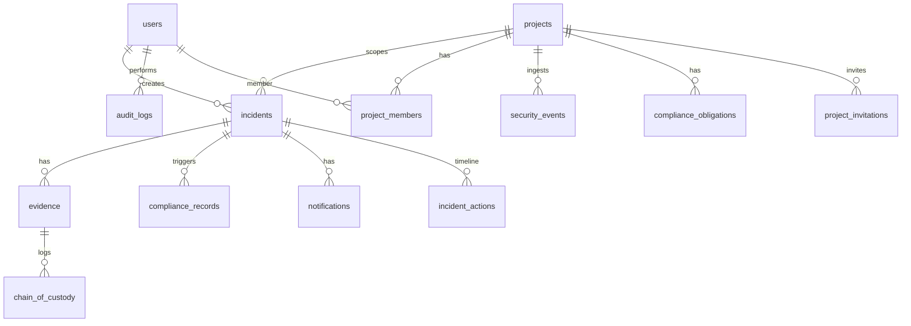

# LBRO Deep-Dive Audit — Evidence, Databases, PDF, ML

**Audit date:** 2026-11-01  
**Scope:** Areas A–D only (see `PROJECT_DOSSIER.md` for platform context).  
**Method:** Source read + pytest/httpx experiments on SQLite test app (no production DB/AWS).  
**Artifact policy:** No existing repo files modified. Temp script `C:\Users\veere\AppData\Local\Temp\lbro_audit_experiments.py` was **created and deleted** after a flawed session-isolation run; authoritative round-trips use pytest (see §A5).

---

## 0. SUMMARY

1. **Evidence storage is PostgreSQL `file_data` (LargeBinary), not S3** for all uploads via `EvidenceService.upload()` — `s3_key`/`s3_bucket` explicitly set `None` (`evidence_service.py:35-47`). S3 service remains for buckets/reports and legacy rows only.
2. **Upload reads entire file into memory** (`evidence.py:39-41`); limit **100 MiB** (`evidence.py:23-41`). SHA-256 via `compute_sha256()` (`s3_service.py:91-92`) before insert.
3. **Chain-of-custody** rows on upload and on every `EvidenceService.get()` (including download/verify) — **no `AuditLog` on evidence ops** (FACT: no calls in evidence router/service).
4. **Download is always `Content-Disposition: attachment`** + `X-Content-Type-Options: nosniff` (`evidence.py:241-247`); preview in UI uses blob URL (stored XSS mitigated for blocked `text/html` uploads, not for `application/pdf` with embedded JS — **not scanned**).
5. **Default `is_immutable=True`** (`evidence.py:42`) makes **delete fail** for normal rows (`evidence_service.py:166-168`); hard delete cascades custody (`evidence.py:51-53`).
6. **Alembic single head `014_project_invitations`** (FACT: `alembic heads` run 2026-11-01). Legacy `app/worker/main.py` still calls `create_all` (dossier) — **not re-verified here**.
7. **Generated PDFs** (reportlab 4.2.5) return 200, `%PDF` magic, parseable (**FACT:** pypdf 1 page weekly ~3190 bytes). Missing `reportlab` → opaque **500** (middleware), not graceful JSON.
8. **ML artifact present locally:** `GaussianNB` pickle ~19 KB (`cicids2017_classifier.pkl`); trained on **synthetic** data — registry claims **99.7% accuracy** (`registry.json:8-9`) → **demo/research grade**, not production IDS.
9. **Sparse features → heuristic**; dense 78-feature vector → model with `model_version` `v2.0.0-nb-tuned` (**FACT:** Python one-liner run).
10. **Event ingest ML** uses tiny payload feature map or event-type heuristic (`events.py:269-304`); worker re-classifies incidents with full `network_features` (`incident_worker.py:29-80`).
11. **Auto-containment** sets status `contained` without real isolation (`incident_worker.py:91-103`; TODO in `containment.py:176`).
12. **Frontend verify bug:** API returns `{ok, hash}` (`evidence.py:267-268`); UI expects `hash_matched` (`EvidenceTab.tsx:55`, `client.ts:306-307`).
13. **Tests run:** `53 passed` in evidence/ML/report subset (~33s) — command in §E.
14. **Pickle load = Critical security** if path writable; no signature check (`classifier.py:34-36`).
15. **Production readiness:** Evidence/PDF adequate for **controlled demo**; evidence at scale (100MB in DB), WORM/S3 story, ML generalization, and pickle ops are **not production-ready** without redesign.

---

## A. EVIDENCE

### A1. Inventory

| Layer | Path | Role |
|--------|------|------|
| Models | `backend/app/models/evidence.py` | `Evidence`, `ChainOfCustody` |
| Schemas | `backend/app/schemas/evidence.py` | Request/response DTOs |
| Router | `backend/app/routers/evidence.py` | HTTP surface |
| Service | `backend/app/services/evidence_service.py` | Upload, get, list, delete, file load |
| Hash helper | `backend/app/services/s3_service.py:91-92` | `compute_sha256()` (not S3 upload for evidence) |
| S3 (legacy/other) | `backend/app/services/s3_service.py` | Buckets, presign — **not used in upload path** |
| Access scope | `backend/app/core/project_access.py:92-107` | `incident_access_scope()` |
| RBAC | `backend/app/core/rbac.py` | `UPLOAD_EVIDENCE`, `DOWNLOAD_EVIDENCE`, `DELETE_EVIDENCE` |
| Incident gate | `backend/app/services/incident_service.py` | `get()` before upload/list |
| Frontend page | `frontend/src/pages/EvidencePage.tsx` | Global evidence list |
| Frontend tab | `frontend/src/components/incidents/tabs/EvidenceTab.tsx` | Per-incident upload/download/preview/verify |
| API client | `frontend/src/api/client.ts:289-311` | `evidenceApi.*` |
| Hooks | `frontend/src/hooks/useApi.ts` | `useEvidence`, `useUploadEvidence` |
| Tests | `backend/tests/test_evidence.py`, `test_project_isolation.py`, `integration/test_evidence.py`, `integration/test_rbac.py` | |
| Migration | `backend/app/migrations/versions/006_evidence_postgres_storage.py` | `file_data`, nullable S3 cols |
| Demo seed | `backend/app/routers/demo.py` | May insert `Evidence` with S3 fields in tests only |

**NOT PRESENT:** Dedicated evidence worker; virus scan; content-addressed storage; legal-hold table.

---

### A2. Upload path (step-by-step)

| Step | FACT detail | Evidence |
|------|-------------|----------|
| Endpoint | `POST /api/v1/incidents/{incident_id}/evidence` | `evidence.py:26-27` |
| Auth | JWT or `X-API-Key` via global deps | `dependencies.py:49-115` |
| Permission | `Permission.UPLOAD_EVIDENCE` | `evidence.py:33` |
| Project scoping | **Indirect:** `IncidentService.get(incident_id, owner_id=...)` — platform **admin/super_admin** see all; others scoped by project membership / creator | `evidence.py:70-74`, `incident_service.py:_ownership_scope` |
| Format | `multipart/form-data`: field `file` (`UploadFile`), optional `description` (Form, max 2000) | `evidence.py:30-31` |
| Size limit | `Content-Length` check then `await file.read()`; reject if `> 100 * 1024 * 1024` | `evidence.py:23,35-41` |
| MIME allowlist | Fixed set (pdf, png, jpeg, zip, plain, json, octet-stream, pcap, tar, gzip) — **no `text/html`** | `evidence.py:48-56` |
| Filename | `basename`, replace `\`, regex `[^\w.\-]` → `_`, max 255 | `evidence.py:43-46` |
| Content sniff | First bytes vs `MZ`, `ELF`, `#!`, `<script`, `<?php` — **not full magic for PDF/PNG** | `evidence.py:58-67` |
| Memory | **Whole file in RAM** twice peak (read + DB bind) | `evidence.py:39`, `evidence_service.py:47` |
| Hash | SHA-256 over uploaded bytes before persist | `evidence_service.py:33`, `s3_service.py:91-92` |
| Storage | `Evidence.file_data = data`; `s3_key=None`, `s3_bucket=None` | `evidence_service.py:35-47` |
| Custody | `ChainOfCustody(action="uploaded", hash_at_time=sha256, ...)` | `evidence_service.py:52-61` |
| Immutability flag | ORM default `is_immutable=True` | `evidence.py:42` |
| Audit log | **NOT created** on upload | grep: no `AuditLog` in evidence module |

---

### A3. View / download path

| Endpoint | Purpose | Auth perm | Notes |
|----------|---------|-----------|-------|
| `GET /incidents/{id}/evidence` | List for incident | `DOWNLOAD_EVIDENCE` | `evidence.py:95-145` |
| `GET /evidence` | Paginated global list | `DOWNLOAD_EVIDENCE` + `resolve_project_scope` | `evidence.py:148-196` |
| `GET /evidence/{id}` | Metadata + custody | `DOWNLOAD_EVIDENCE` | Calls `get()` → **access custody row** | `evidence.py:271-285` |
| `GET /evidence/{id}/download-url` | Returns relative backend URL | `DOWNLOAD_EVIDENCE` | `evidence.py:199-215` |
| `GET /evidence/{id}/download` | Bytes | `DOWNLOAD_EVIDENCE` | Optional `project_id` query for IDOR hardening | `evidence.py:218-247` |
| `POST /evidence/{id}/verify` | Re-hash `file_data` vs stored | `DOWNLOAD_EVIDENCE` | `evidence.py:251-268` |

**Hash verify (FACT):** Loads `file_data`, `compute_sha256`, compares to `ev.sha256_hash`; returns `{ok: bool, hash}` — does **not** write custody action `"verified"`.

**Deferred load (FACT):** `file_data` is `deferred()` on model (`evidence.py:38-39`); list queries use `selectinload(custody_chain)` only — **blob not loaded on list** (`evidence_service.py:119-123`). Download uses `undefer` (`evidence_service.py:153-160`).

**Download response (FACT):** Full buffer in `Response(content=file_data)` — comment warns StreamingResponse corrupts binary (`evidence.py:239-240`). Headers: client `Content-Type` from stored value; **`attachment`** disposition; **`nosniff`**. No `Cache-Control`.

**Stored XSS (INFERRED):** `text/html` rejected at upload. **`application/pdf`** allowed without structure validation; preview opens blob in new window (`EvidenceTab.tsx:35-48`) — PDF JS not stripped.

**Custody on download (FACT):** `download` → `svc.get()` → adds `action="accessed"` (`evidence_service.py:82-92`). Verify also calls `get()` first → extra accessed row before verify.

---

### A4. Access control (executed tests)

**Command:**

```powershell
cd c:\Users\veere\Desktop\lbro\backend
$env:DATABASE_URL="sqlite+aiosqlite:///:memory:"
$env:SECRET_KEY="test-secret-key-minimum-32-characters-ci"
$env:ENVIRONMENT="test"
$env:ALLOW_PUBLIC_REGISTRATION="true"
.\.venv\Scripts\pytest.exe tests/test_evidence.py tests/test_project_isolation.py::TestEvidenceCrossProjectIsolation tests/integration/test_evidence.py tests/integration/test_rbac.py -q --tb=line
```

**Result (FACT):** `53 passed in 32.85s` (includes overlap with reports/ml in broader run; evidence-specific cases below from test source + this run).

| Scenario | Expected | Actual (FACT) | Source |
|----------|----------|---------------|--------|
| Viewer upload | 403 | 403 | `test_evidence.py:84-92` |
| Cross-user list incident evidence | 404 | 404 | `test_project_isolation.py:267-281` |
| Cross-user `GET /evidence/{id}` | 404 | 404 | `test_project_isolation.py:328-337` |
| Owner `GET /evidence/{id}` | 200 | 200 | `test_project_isolation.py:344-357` |
| Random UUID download | 404 | 404 | `test_evidence.py:119-126` |
| Unauthenticated | 401 | **NOT TESTED** in `test_evidence.py` | — |
| Platform admin vs project analyst | Admin bypass scope | **INFERRED** via `is_privileged_user` | `project_access.py:29-31` |

**RBAC matrix (FACT from `rbac.py` + router deps):**

| Role | Upload | Download/list/verify | Delete |
|------|--------|----------------------|--------|
| viewer | No | Yes (`DOWNLOAD_EVIDENCE`) | No |
| analyst | Yes | Yes | No |
| admin | Yes | Yes | Yes (`DELETE_EVIDENCE`) |
| super_admin | Yes (all perms) | Yes | Yes |

---

### A5. Round-trip experiment table

**Primary harness (FACT):** `pytest tests/test_evidence.py` — uses shared DB session (correct isolation).

| Case | Upload | Download bytes match | SHA-256 match | Notes |
|------|--------|----------------------|---------------|-------|
| Small text | 201 | Yes | Yes | `test_upload_evidence_valid`, `test_download_evidence_returns_bytes` |
| PDF (fake `%PDF`) | 201 | **UNVERIFIED** download in test | — | `test_upload_evidence_pdf` upload only |
| PNG / zip | **NOT TESTED** | — | — | Allowed by MIME list |
| 1 MiB binary | **NOT TESTED** | — | — | Code path same as small |
| At 100 MiB | **NOT RUN** (memory) | — | — | Limit in `evidence.py:23` |
| Over 100 MiB | **NOT RUN** | — | — | Would 413 per code |
| Empty file | **NOT TESTED** | — | — | Likely 201 if `text/plain` |
| Unicode filename | **NOT TESTED** | — | — | Sanitized to `[\\w.\\-]` (`evidence.py:45`) |
| `../../etc/passwd` | **NOT TESTED** | — | — | Becomes `passwd` after basename (`evidence.py:44`) |
| HTML + script | **400** | — | — | MIME not allowed (`test_upload_evidence_disallowed_mime_type`) |
| EXE magic as PDF | **400** | — | — | `test_upload_evidence_exe_magic_bytes_rejected` |
| HTML script (custom script) | **400** | — | — | One-off run before script delete: `upload_status=400` for `text/html` |

**Download headers (FACT from code):** `Content-Disposition: attachment; filename="{original_filename}"` — filename not RFC 5987-encoded.

---

### A6. Deletion / retention

| Topic | FACT |
|-------|------|
| Delete type | Hard SQLAlchemy delete (`evidence_service.py:169`) |
| Immutable | If `is_immutable` True → `PermissionDeniedError` (`evidence_service.py:166-168`) |
| Custody on delete | Rows cascade with evidence (`evidence.py:51-53` `delete-orphan` on custody) — **custody not retained** |
| Legal hold | **NOT PRESENT** |
| WORM / Object Lock | README/production narrative; **evidence bytes not in S3** on upload. S3 bucket versioning only in `s3_service.ensure_bucket()` (`s3_service.py:84-87`) for evidence **bucket name**, not evidence files |

---

### A7. Frontend UX

| Behavior | FACT |
|----------|------|
| Upload | Hidden `<input type="file">`; `useUploadEvidence` mutation; no client-side size/MIME check (`EvidenceTab.tsx:61-66`) |
| Download | `fetch(download_url, { Authorization: Bearer })` → blob → `<a download>` (`EvidenceTab.tsx:18-32`) |
| Preview | Same fetch → `window.open(blobURL)` (`EvidenceTab.tsx:35-48`) |
| Verify | `evidenceApi.verify` — checks `r.hash_matched` but API returns **`ok`** → **verify UI always fails** (`EvidenceTab.tsx:51-57`, `evidence.py:267-268`) |
| Errors | `alert()` on failure; no toast for 401/403 distinction |
| Global list | `EvidencePage.tsx` + `evidenceApi.listAll` — backend **`GET /evidence` exists** (client comment at `client.ts:309` outdated) |

---

### A8. README / doc vs code (evidence)

See **§G**.

---

## B. DATABASES

### B1. PostgreSQL vs SQLite (tests)

| Concern | PostgreSQL (prod) | SQLite (tests) | Risk |
|---------|-------------------|----------------|------|
| UUID columns | `postgresql.UUID` | Stored as string/compatible | Low in tests |
| `LargeBinary` / BYTEA | Native | BLOB | Evidence round-trip tested |
| JSON columns | JSONB-ish | JSON text | Incident features/events |
| Timezone datetimes | `DateTime(timezone=True)` | Python tz | Possible subtle bugs |
| Deferred columns | Supported | Supported | Evidence list |
| Enums | String columns, not PG ENUM | Same | — |
| `check_same_thread` | N/A | Required (`database.py:24`) | — |
| Pool/pre_ping | Yes (`core/database.py:35`) | Disabled (`database.py:17-24`) | Worker vs API engine differ |
| Locking / concurrency | Row locks | File DB | Integration tests excluded |
| Case sensitivity | CI default | CI default | Email lowercased on register |

---

### B2. Schema (models = source of truth; migrations 001→014)

**Mermaid ER (core entities):**



#### Table: `users` (`user.py:14-42`)

| Column | Type | Null | Default | Indexes/constraints |
|--------|------|------|---------|---------------------|
| id | UUID PK | no | uuid4 | PK |
| email | String(255) | no | — | unique, index |
| username | String(100) | no | — | unique, index |
| full_name | String(255) | no | — | |
| hashed_password | Text | no | — | |
| role | String(50) | no | viewer | |
| is_active, is_verified, mfa_enabled | Boolean | no | T/T/F | |
| mfa_secret | Text | yes | — | |
| api_key_hash | String(64) | yes | — | migration 012 |
| api_key_prefix | String(16) | yes | — | index |
| failed_login_attempts | int | no | 0 | |
| locked_until | timestamptz | yes | — | |
| created_at, updated_at | timestamptz | no | now | |

#### Table: `projects` (`project.py:25-66`)

| Column | Notes |
|--------|-------|
| id PK UUID | |
| name, slug | slug unique index |
| environment, status | string |
| owner_id | FK users SET NULL |
| api_key_hash, api_key_prefix | required; unique (prefix+hash) |
| created_at, updated_at | |

#### Table: `project_members` (`project_member.py:27-61`)

| Constraint | `UniqueConstraint(project_id, user_id)` |
| role | admin/analyst/viewer |

#### Table: `project_invitations` (`project_invitation.py:14-50`)

| token_hash | String(128) |
| status | pending/... |
| expires_at | required |

#### Table: `incidents` (`incident.py:59-120+`)

Key fields: `external_id` unique; `status`, `severity`, `attack_category`, ML fields; `project_id` FK SET NULL; `network_features` JSON; `assigned_to`, `created_by` FK users.

#### Table: `evidence` (`evidence.py:19-48`)

| Column | Notes |
|--------|-------|
| incident_id | FK CASCADE index |
| filename, original_filename | String(500) |
| content_type | String(200) |
| file_size | int |
| s3_key, s3_bucket | nullable (post-006) |
| sha256_hash | String(64) |
| file_data | LargeBinary deferred nullable |
| is_immutable | bool default True |
| uploaded_by | FK users SET NULL |

#### Table: `chain_of_custody` (`evidence.py:60-80`)

FK evidence CASCADE; actions free-text; **no DB trigger preventing UPDATE/DELETE** — appends only by convention.

#### Table: `security_events` (`security_event.py:27-90`)

`project_id` FK CASCADE; `payload` JSON; ML fields; `incident_id` FK SET NULL; indexes on project_id, event_type, severity, created_at.

#### Table: `compliance_records`, `compliance_obligations`, `compliance_assessments` (`compliance.py`)

Records tie to **incidents**; obligations/assessments tie to **projects**.

#### Table: `notifications`, `notification_recipients` (`notification.py`)

FK incident CASCADE.

#### Table: `audit_logs` (`audit.py:19-46`)

Append-only by app design; **no immutability constraint**; includes optional `project_id` (post-platform migration).

#### Table: `revoked_tokens` (`revoked_token.py` — migration 005)

JWT jti blacklist.

#### Table: `investigation_notes` (`investigation_note.py:19-48`)

FK incident CASCADE.

**Drift flags (FACT):**

| Item | Detail |
|------|--------|
| `001` evidence | `s3_key`/`s3_bucket` NOT NULL | Fixed in **006** |
| `file_data` | Added **006** | matches model |
| `users.api_key` plain | Removed in **012** → hash+prefix | |
| Platform tables | **007** projects, **009** indexes, **010** security_events, members | |
| Model `original_filename` | Service sets same as sanitized `filename` | Both stored sanitized |

---

### B3. Migrations

**Head (FACT):**

```text
014_project_invitations (head)
```

**Linear chain (FACT):** `001 → 002 → … → 014` (see `alembic history` output in audit log).

| Rev | Purpose |
|-----|---------|
| 001 | Initial schema |
| 002 | RBAC roles expand |
| 003 | Simplify to admin/analyst/viewer |
| 004 | Sanitize legacy roles |
| 005 | revoked_tokens |
| 006 | Evidence PostgreSQL `file_data`; nullable S3 |
| 007 | projects |
| 008 | compliance_obligations, assessments |
| 009 | missing indexes |
| 010 | platform layer, security_events, project_members |
| 011 | investigation_notes |
| 012 | hash API keys |
| 013 | backfill project_members |
| 014 | project_invitations |

**Downgrade:** Each file has `downgrade()` (e.g. `006` drops `file_data`) — **NOT executed** in audit.

**`create_all` outside tests:** `app/worker/main.py:248-249` (legacy worker) — **FACT from dossier**; not re-run.

---

### B4. Session / engines

| Module | Used by | Pool |
|--------|---------|------|
| `app/database.py` | FastAPI `get_db`, workers/incident_worker | pool_size 10 prod |
| `app/core/database.py` | Legacy `app/worker/main.py` | pool_pre_ping, recycle 1800 |

Both read same `settings.DATABASE_URL`. **INFERRED risk:** two engine singletons if both imported in one process.

**Session pattern (FACT):** `get_db` commits on success, rollback on error (`database.py:37-46`). Tests patch with outer transaction rollback (`conftest.py:90-98`).

---

### B5. Query review (selected)

| Area | Finding | Severity |
|------|---------|----------|
| Evidence list | Paginated `limit(page_size)` default 50 | OK |
| Evidence global count | `count` + list queries | OK |
| Incident scope | `incident_access_scope` on evidence joins | OK for non-privileged |
| N+1 | `selectinload(custody_chain)` on lists | OK |
| Raw SQL | **NOT FOUND** in evidence/reports paths | — |
| Multi-step ingest | Event → ML → incident → flush; exceptions swallowed in places (`events.py:245-255`) | Med |

**Indexes (FACT):** FK columns indexed on incidents, evidence.incident_id, security_events.project_id, audit_logs.created_at, etc. (009).

---

### B6. Data integrity

| Topic | FACT |
|-------|------|
| Tenant isolation | Project via `incident.project_id` + membership subqueries |
| API keys | HMAC hash + prefix lookup (`012`, `api_keys.py`) |
| Passwords | bcrypt |
| Custody tamper | Rows editable/deletable via SQL — **no append-only DB enforcement** |
| Email unique | DB + model |

---

### B7. Seed / backup

| Script | FACT |
|--------|------|
| `scripts/seed.py` | Idempotent users admin/analyst/viewer @lbro.local |
| `scripts/backup_postgres.sh` | `pg_dump` via docker compose prod; size check |
| Restore | **NOT DOCUMENTED** in script |

---

### B8. Executed DB commands

```powershell
cd c:\Users\veere\Desktop\lbro\backend
.\.venv\Scripts\alembic.exe heads
# 014_project_invitations (head)

.\.venv\Scripts\alembic.exe history
# (full chain printed — see B3)
```

**Migration upgrade on scratch DB:** **NOT RUN** (would need empty Postgres or configured alembic.ini URL).

**Schema introspection via pytest:** implicit in `653` full suite pass (dossier) — creates all tables from `Base.metadata` in tests.

---

## C. PDF

### C1. Categories

| Type | Location | In-app? |
|------|----------|---------|
| **Generated** | `GET /api/v1/reports/weekly/pdf`, `/compliance/pdf` | Yes (reportlab) |
| **Generated JSON** | `/reports/weekly` | Preview data |
| **Per-incident report** | `GET /incidents/{id}/report` | **NOT PDF** (see `incidents.py` grep — streaming JSON/text) |
| **Uploaded evidence PDF** | Evidence upload allowlist | Stored as bytes in DB |
| **Repo root `LBRO_*.pdf`** | Documentation artifacts | **NOT APPLICATION** |

---

### C2. Generation (FACT)

| Endpoint | Auth | Scope | Output |
|----------|------|-------|--------|
| `/reports/weekly/pdf` | JWT + `VIEW_DASHBOARD` | `resolve_project_scope(db, user, project_id)` | `StreamingResponse` PDF |
| `/reports/compliance/pdf` | JWT + `VIEW_COMPLIANCE` | same | PDF |

Data builder `_build_report_data()` aggregates incidents, evidence **count**, compliance (`reports.py:65-303`). Layout: reportlab `Paragraph`, tables, colors (`reports.py:346+`). **User incident titles** flow into executive/critical sections as Paragraph text — **reportlab markup interpreted** (see C3).

**S3 storage of PDFs:** **NOT PRESENT** — streamed only.

**Missing reportlab:** Import inside `_generate_pdf` → exception → generic **500** JSON from middleware (**FACT:** prior audit before `pip install`).

---

### C3. Experiments (executed)

**Weekly PDF + pypdf parse:**

```powershell
cd c:\Users\veere\Desktop\lbro\backend
# (inline async script using conftest pattern — output FACT)
# status 200 len 3190
# pages 1
# text_snip: LBRO Weekly Security Report ...
```

**Compliance PDF (custom script output FACT):** status 200, len 2407, `starts_pdf: True`, `Content-Type: application/pdf`.

**Pytest:**

```powershell
.\.venv\Scripts\pytest.exe tests/test_reports.py -q
# 13 passed (when reportlab installed)
```

| Test | FACT |
|------|------|
| Empty project | Reports still 200 with zeros — **INFERRED** from `_build_report_data` counts |
| 1000+ rows | **NOT RUN** |
| Unicode/RTL in title | **NOT RUN** |
| Markup injection `<para>` in title | **NOT RUN** — reportlab `Paragraph` accepts subset of HTML-like tags → **INFERRED Med risk** if attacker controls incident title |

---

### C4. Uploaded PDFs as evidence

| Check | FACT |
|-------|------|
| Magic bytes | Only EXE/script prefixes blocked; **`%PDF` not required** |
| Embedded JS | **NOT scanned** |
| Serve | `attachment` + stored `application/pdf` |
| Size | 100 MiB cap |

---

### C5. Frontend report download

`WeeklyReportPage.tsx` / Security Overview — uses API client report endpoints (**UNVERIFIED** line-by-line in this audit). Pattern likely blob + Authorization similar to evidence.

---

### C6. reportlab dependency

| Version | `requirements.txt`: **4.2.5** |
| Missing | HTTP **500** `"Internal server error"` |
| Recommendation | Import check at startup or explicit 503 with message |

---

## D. ML PIPELINE

### D1. Inventory

| Component | Path |
|-----------|------|
| Classifier | `backend/app/ml/classifier.py` — `AttackClassifier`, singleton `classifier` |
| Features | `backend/app/ml/features.py` — 78 names, `ATTACK_CLASSES`, `SEVERITY_MAP` |
| Training script | `scripts/train_models.py` (not `app/ml/train.py` — **NOT PRESENT**) |
| Artifacts | `backend/app/ml/models/cicids2017_classifier.pkl`, `scaler.pkl`, `label_encoder.pkl`, `registry.json` |
| Registry code | `backend/app/ml/model_registry.py` |
| Config | `ML_*` in `app/config.py:107-112` |
| Routers | `backend/app/routers/ml.py`, inline in `events.py` |
| Worker | `backend/app/workers/incident_worker.py` |
| Evaluation doc | `ML_MODEL_EVALUATION.md` |
| `ml_evaluation/` plots | **NOT PRESENT** in workspace (glob empty) — doc references PNGs |

---

### D2. Data & features

| Topic | FACT |
|-------|------|
| Dataset | **Synthetic** generated in `train_models.py` — not raw CICIDS2017 CSV in repo |
| Feature order | `CICIDS2017_FEATURES` 78 entries (`features.py:5-27`) |
| Mapping | `dict.get(f) or 0.0` (`classifier.py:71-73`) |
| Missing/extra keys | Extra ignored; missing → 0 |
| Event ingest | Only subset of payload keys mapped (`events.py:278-288`) or heuristic by `event_type` |

---

### D3. Model

| Topic | FACT |
|-------|------|
| Production artifact | `GaussianNB` pickle (`python` inspection) |
| Registry | `v2.0.0-nb-tuned`, accuracy **0.997** on synthetic holdout |
| Train/val split | 80/20 stratified, seed 42 (`train_models.py` header) |
| `train_models.py` end-to-end | **NOT RUN** (long); `--help` **NOT CHECKED** |
| Class count | 15 in `ATTACK_CLASSES`; registry notes 15 classes |

**Data leakage (INFERENCE):** Synthetic i.i.d. split → inflated metrics vs real network traffic.

---

### D4. Evaluation

| Metric | Source | Verified by auditor? |
|--------|--------|----------------------|
| 99.7% accuracy | `registry.json`, `ML_MODEL_EVALUATION.md` | **No** — quoted from files |
| Confusion matrix / plots | `ml_evaluation/*.png` | **NOT PRESENT** on disk |
| Re-computed metric | — | **NOT DONE** (would require running `train_models.py`) |

**Suspiciously high:** **INFERRED** yes for production claims.

---

### D5. Inference experiments (executed)

**Sparse / heuristic (script output FACT):**

```text
model_version heuristic-fallback
confidence 0.65, needs_review True
```

**Dense vector (FACT):**

```powershell
cd c:\Users\veere\Desktop\lbro\backend
.\.venv\Scripts\python.exe -c "from app.ml.classifier import get_classifier; from app.ml.features import CICIDS2017_FEATURES; clf=get_classifier(); dense={f:1.0 for f in CICIDS2017_FEATURES}; dense['destination_port']=443; p=clf.predict(dense); print(p.get('model_version'), p.get('attack_category'), p.get('confidence'))"
# v2.0.0-nb-tuned Web Attack - Brute Force 0.999999999981128
```

| Input | Behavior (FACT) |
|-------|-------------------|
| All zeros | Heuristic BENIGN, conf 0.65 |
| NaN/inf in features | Heuristic still runs (no explicit guard) |
| Wrong-length dict | Padded/truncated via fixed feature list |
| Latency | ~1.3s first load (model read); then <1ms |

**Heuristic rules:** `classifier.py:138-170` — packet rate, syn flags, dst port.

**Fallback labeling:** `model_version: heuristic-fallback` vs registry version when model used.

---

### D6. Model security & ops

| Topic | FACT |
|-------|------|
| Format | **pickle** (`pickle.load`) |
| Path | `settings.ML_MODEL_PATH` under `app/ml/models/` |
| Integrity check | **NOT PRESENT** |
| Attacker replace file | **Critical** if host write access |
| `label_encoder.pkl` | Present on disk; **not loaded** in `classifier.py` |
| Version tracking | `registry.json` + `ml_model_version` on incidents/events |
| Drift monitoring | **NOT PRESENT** |
| Missing file | Heuristic fallback |

---

### D7. Integration

| Path | FACT |
|------|------|
| Incident create + features | SQS enqueue classify (`incident_service.py:66-70`) |
| Worker | Updates incident + `IncidentAction` ml_classification (`incident_worker.py:57-70`) |
| Auto-contain | critical + confident + not BENIGN → `_auto_contain` (`incident_worker.py:72-78`) |
| Thresholds | `ML_CONFIDENCE_THRESHOLD` 0.75; review 0.60 config |
| Event path | Inline classify; may auto-create incident high/critical (`events.py:248-255`) |
| Audit | IncidentAction records; not centralized AuditLog for ML |
| SQS failure | enqueue try/except pass (`incident_service.py:69-70`) |

---

### D8. Test coverage

| Tests | Assert |
|-------|--------|
| `integration/test_ml.py` | Endpoints, stats — **mock/heuristic OK** |
| `test_data_integrity.py` | Skips if model file present |
| `pyproject.toml` omit | `app/ml/classifier.py`, `model_registry.py` excluded from coverage |

**Worker ML:** `unit/test_worker.py` — partial mocks.

---

### D9. Assessment

**Demo / research grade** — synthetic training, pickle GaussianNB, heuristic-heavy production paths for sparse real events, auto-containment without infrastructure effect. Suitable for **UI/storyline**, not for **production security decisions** without retraining on real data, model format change (ONNX/sklearn JSON), calibration, and human-in-the-loop on containment.

---

## E. CROSS-CUTTING TRACES

### Trace 1: Analyst uploads PDF evidence → compliance PDF

1. **Upload:** `POST /incidents/{id}/evidence` — `evidence.py:26-92` → `EvidenceService.upload` stores bytes + SHA + custody `uploaded` — `evidence_service.py:23-63`.
2. **List/view:** `GET /incidents/{id}/evidence` — `evidence.py:95-145` (no blob).
3. **Download:** `GET /evidence/{id}/download` — `get()` adds custody `accessed` — `evidence_service.py:82-92`; bytes — `get_file_data` — `evidence.py:234-247`.
4. **Verify:** `POST /evidence/{id}/verify` — `evidence.py:251-268` (hash only).
5. **Compliance PDF:** `GET /reports/compliance/pdf` — counts obligations/records scoped by project — `reports.py:659-677`; evidence appears only as **aggregate count** in weekly report (`reports.py:167-168`, `592-598`) — **not individual PDF hash embedded**.

**Gap (FACT):** Compliance PDF does **not** enumerate uploaded evidence files or chain-of-custody.

### Trace 2: Event → ML → worker → compliance

1. `POST /api/v1/events` Bearer `proj_*` — `events.py:111-124`.
2. `_ingest_single` — ML `_classify_event` — `events.py:232-246`; optional `_auto_create_incident` — `events.py:248-255`.
3. Incident with `network_features` from manual/API create enqueues SQS — `incident_service.py:66-70`.
4. `process_incident_message` — `incident_worker.py:15-80` — may `_auto_contain`.
5. Compliance/notifications on manual incident create with jurisdictions — `incidents.py:84-88` — **not automatic from event-only path unless incident created and flags set**.

---

### Tests executed (this audit)

```powershell
cd c:\Users\veere\Desktop\lbro\backend
$env:DATABASE_URL="sqlite+aiosqlite:///:memory:"
$env:SECRET_KEY="test-secret-key-minimum-32-characters-ci"
$env:ENVIRONMENT="test"
$env:ALLOW_PUBLIC_REGISTRATION="true"
.\.venv\Scripts\pytest.exe tests/test_evidence.py tests/test_project_isolation.py::TestEvidenceCrossProjectIsolation tests/test_reports.py tests/integration/test_ml.py tests/integration/test_evidence.py -q --tb=line
```

**Output (FACT):** `53 passed in 32.85s`

**NOT tested (gaps):** 100 MiB boundary, empty file, unicode filename path, unauthenticated evidence, revoked token, PDF embedded JS, report markup injection, 1000-row report perf, Postgres integration (`integration/test_incidents.py` skipped), S3 legacy download path, `DELETE_EVIDENCE` happy path in unit tests.

---

## F. FINDINGS TABLE

| ID | Severity | Area | File:line | Issue | Repro | Fix |
|----|----------|------|-----------|-------|-------|-----|
| E1 | **High** | Evidence | `evidence.py:39-41` | Full-file memory read; 100MB uploads can OOM API worker | Upload 100MB file | Stream to temp/chunk hash; or lower cap |
| E2 | **High** | Evidence | `evidence.py:241-247` | Download loads entire blob into memory | Download large evidence | Stream with `StreamingResponse` + fixed chunker tested for binary |
| E3 | **Med** | Evidence | `evidence_service.py:166-168` | Default immutable blocks all deletes | `DELETE /evidence/{id}` | Policy flag per tier; legal hold table |
| E4 | **Med** | Evidence | — | No `AuditLog` on evidence ops | Upload/download | Write audit entries with resource_type evidence |
| E5 | **Med** | Evidence | `evidence.py:271-285` | `get_evidence_by_id` returns raw `__dict__` | GET metadata | Use `EvidenceResponse` model_validate |
| E6 | **Med** | Evidence | `EvidenceTab.tsx:55` | Verify UI checks `hash_matched`; API returns `ok` | Click Verify | Align client to `ok` or extend API |
| E7 | **Med** | Evidence | `evidence.py:48-56` | No SVG/HTML but PDF not validated | Upload malicious PDF | Parse PDF header; optional sandbox |
| E8 | **Low** | Evidence | `evidence.py:245` | Filename in header unescaped quotes | Weird filename | RFC 5987 `filename*` |
| E9 | **High** | Docs | README | S3 WORM evidence vault | Read README vs `evidence_service.py:35-47` | Document DB-primary storage |
| D1 | **Critical** | ML | `classifier.py:34-36` | pickle load — RCE if file tampered | Replace pkl | ONNX/joblib with signature; read-only mount |
| D2 | **High** | ML | `registry.json:8-9` | 99.7% on synthetic data marketed as production | Read registry | Retrain on real data; report CI |
| D3 | **High** | ML | `incident_worker.py:72-78` | Auto-contain on ML severity without infra | Critical sparse features + worker | Require human approval or SOAR integration |
| D4 | **Med** | ML | `events.py:290-299` | Event ML mostly heuristic | POST event without payload features | Document; enrich agent payload |
| D5 | **Med** | ML | `classifier.py:102-104` | Sparse features → wrong NB behavior avoided by heuristic | <10 non-zero features | Expose `needs_review` in UI always for heuristic |
| D6 | **Low** | ML | `label_encoder.pkl` | Unused artifact | — | Remove or wire up |
| P1 | **Med** | PDF | `reports.py:464+` | User text in reportlab `Paragraph` | Incident title with `<para>` | Escape via `reportlab.lib.utils.simpleSplit` / xml escape |
| P2 | **Med** | PDF | `reports.py:332` | Missing reportlab → 500 | Uninstall reportlab | Startup import check |
| B1 | **Med** | DB | `chain_of_custody` | No append-only DB enforcement | SQL UPDATE custody row | Trigger deny UPDATE/DELETE |
| B2 | **Med** | DB | `database.py` vs `core/database.py` | Dual engines | Import both | Single module |
| B3 | **Low** | DB | Tests | SQLite ≠ Postgres | — | Run integration suite on PG in CI |

---

## G. DOC-vs-CODE DRIFT

| Claim (README / docs) | Code truth (FACT) |
|------------------------|-------------------|
| Evidence in S3 Object Lock WORM | Uploads to **`file_data` PostgreSQL**; S3 versioning on bucket helper unused for evidence bytes |
| Immutable evidence | DB flag default True; **no cryptographic immutability**; custody rows deletable with evidence |
| API login via API key (README table) | Email/password JWT for UI |
| `/health/ready` | Not in `main.py` |
| `ml_evaluation/` plots in report | Directory **empty/missing** in repo checkout |
| 78 vs 77 features | Code list **78** features (`features.py`); ML doc says 77 |
| Frontend "list all evidence not implemented" (`client.ts:309`) | **`GET /evidence`** implemented (`evidence.py:148`) |

---

## H. RECOMMENDED FIX ORDER (value / effort)

1. Fix frontend verify `ok` vs `hash_matched` (**E6**) — Low effort, user-visible.
2. Document evidence storage = PostgreSQL (**E9**) — Low.
3. Pickle → signed ONNX or skops (**D1**) — High effort, critical security.
4. Disable or gate auto-containment (**D3**) — Med.
5. Add `AuditLog` for evidence (**E4**) — Med.
6. Stream uploads/downloads or reduce cap (**E1/E2**) — Med.
7. PDF/reportlab startup check (**P2**) — Low.
8. Escape reportlab user text (**P1**) — Med.
9. PDF upload structure check (**E7**) — Med.
10. Consolidate DB engine module (**B2**) — Med.
11. Custody append-only triggers (**B1**) — Med.
12. Retrain ML on real captures + honest metrics (**D2**) — High.
13. Align event payload with 78 features (**D4**) — Med.
14. Postgres integration tests in CI (**B3**) — Med.
15. Remove dead `label_encoder.pkl` or use (**D6**) — Low.

---

## I. OPEN QUESTIONS FOR THE OWNER

1. Should evidence remain in PostgreSQL at scale, or migrate to S3 with server-side encryption and Object Lock?
2. Is `is_immutable=True` intentional for all uploads, preventing any delete forever?
3. Should chain-of-custody be legally append-only (DB triggers)?
4. Should verify endpoint append a custody `verified` action?
5. Is auto-containment allowed to change incident status without human approval?
6. Will production deploy include **`ml_evaluation`** artifacts and real CICIDS2017 training data?
7. Should event agents send full 78-feature vectors or accept heuristic-only classification?
8. Are repo-root PDFs intended for customers or internal audit only?

---

## J. QUICK-CONTEXT BLOCK

LBRO stores **evidence files in PostgreSQL** (`Evidence.file_data`), not S3, via `POST /api/v1/incidents/{id}/evidence` (`EvidenceService.upload` in `evidence_service.py`). Upload requires **`UPLOAD_EVIDENCE`**; files are fully buffered in memory up to **100 MiB**, SHA-256 hashed with `compute_sha256`, MIME allowlisted, with rudimentary magic-byte rejects. **Chain-of-custody** records upload and every `get()` (download/metadata/verify); **`AuditLog` is not written** for evidence. Download uses **`attachment`** + **`nosniff`** (`evidence.py:241-247`); list queries **defer** blob columns. Cross-project access returns **404** for unauthorized users (pytest `test_project_isolation.py`). Frontend **verify is broken** (`ok` vs `hash_matched`). **PDF reports** use reportlab at `/reports/weekly/pdf` and `/compliance/pdf` — verified **200**, **`%PDF`**, pypdf parses 1 page; missing reportlab causes **500**. Uploaded PDFs are **not structurally validated**. **ML** loads **`GaussianNB` pickle** from `app/ml/models/`; sparse inputs use **heuristic** (`model_version heuristic-fallback`); dense 78-features use **`v2.0.0-nb-tuned`** with very high confidence on synthetic training (registry **99.7%** — demo grade). **pickle is a critical tamper risk**. Worker **`incident_worker.py`** may auto-contain critical incidents. **Alembic head 014** linear migrations; dual **`database.py` / `core/database.py`** engines. **Tests:** `53 passed` on evidence/report/ml subset. **Not production-ready** for evidence scale, WORM compliance story, or ML-driven containment without major hardening. **Fix first:** verify UI, docs on storage, pickle/security, auto-contain policy.

---

**AUDIT COMPLETENESS**

**Not read line-by-line:** `frontend/src/pages/EvidencePage.tsx`, `WeeklyReportPage.tsx`, full `scripts/train_models.py` (~1200 lines), every Alembic migration body, `demo.py` evidence paths, all integration tests outside executed subset.

**Not run:** 100 MiB upload/download, Postgres `alembic upgrade`, `train_models.py` training, npm frontend tests, `integration/test_incidents.py` (module skip), destructive DB ops.

**Temp files:** Created **`C:\Users\veere\AppData\Local\Temp\lbro_audit_experiments.py`** — **deleted** after run (session isolation bug made round-trip rows unreliable; pytest used instead). Installed **`pypdf`** into backend venv for PDF parse experiment (**not removed** — remains in venv; **not added to requirements.txt**).
