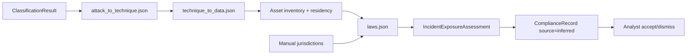

# FEATURE_REPORT: Threat-to-obligation pipeline

## Phase 0 — Baseline (2026-11-01)

**Branch:** `feature/threat-to-obligation` (from `fix/ml-hardening` @ `29b5e02`)

| Check | Command | Result |
|-------|---------|--------|
| Alembic head | `backend\.venv\Scripts\alembic.exe heads` | `017_threat_to_obligation (head)` |
| Backend tests (before) | Phase 0 baseline | `710 passed, 1 deselected` |
| Backend tests (after) | `backend\.venv\Scripts\pytest.exe tests/ -q` | `730 passed, 1 deselected` |
| Frontend (after) | `npm run type-check`; `npm run test -- --run` | pass; `60 passed` (was `58`) |
| `app/compliance` coverage | `pytest tests/test_compliance_*.py tests/test_asset_matching.py --cov=app/compliance --cov-report=term-missing -q` | **90%** total (531 stmts, 54 miss) |

### Current compliance flow (manual jurisdictions)

1. **Incident create** (`app/routers/incidents.py` ~84–88): if `affected_jurisdictions` or personal/health flags, calls `ComplianceService.generate_obligations` and `NotificationService.generate_for_incident`.
2. **ComplianceService** (`app/services/compliance_service.py` ~57–84): loops `REGULATION_RULES`; deadlines from dict hours.
3. **NotificationService** (`app/services/notification_service.py` ~123–167): same jurisdiction logic; deadlines from `settings.*_NOTIFICATION_HOURS`; `status="pending"`.

**Duplicated deadline truth:** reconciled in ADR-001; inferred path uses `laws.json` only.

---

## Phases 1–7 summary

| Phase | Delivered |
|-------|-----------|
| **1** | Knowledge JSON + loader + pure engine (`app/compliance/knowledge/*`, `engine/pipeline.py`); `scripts/verify_attack_mapping.py`; startup validation |
| **2** | Models (`assets`, `asset_residency`, `incident_assets`, `incident_exposure_assessments`), migration `017_threat_to_obligation`, matching (`app/compliance/matching.py`), RBAC `VIEW_ASSETS` / `MANAGE_ASSETS` / `CONFIRM_EXPOSURE`, APIs `/assets`, `/knowledge/*`, incident exposure routes |
| **3** | `exposure_service.py`, worker action `exposure_recompute`, post-ML enqueue; inferred `ComplianceRecord` rows (`source=inferred`, `analyst_decision=pending`); no auto-notification dispatch |
| **4** | `/data-map` page, Incident **Exposure & Obligations** tab, project `compliance-inference` GET/PATCH, client types + Vitest |
| **5** | PDF exposure section (`reports.py`), `scripts/seed.py` demo assets flag `LBRO_SEED_DEMO_ASSETS`, `docs/COMPLIANCE_INFERENCE.md`, `docs/PAPER_NOTES_threat_to_obligation.md`, README |
| **6** | Tests: matching, API, safety, serialize, CI Postgres migration job |
| **7** | Demo transcript below |

### Data flow



### Knowledge inventory (content_version 2026-11-01)

| File | Count / notes |
|------|----------------|
| `attack_to_technique.json` | All `ATTACK_CLASSES` mapped or explicitly unmapped |
| `technique_to_data.json` | Techniques referenced from attack map |
| `data_categories.json` | 15 categories |
| `laws.json` | Rule packs with citations; all `legal_review_status: unreviewed`; see file for `verification_status` per rule |

### Migration proof

```text
alembic heads → 017_threat_to_obligation (head)
CI job backend-migration-postgres: upgrade → downgrade 016 → upgrade
```

---

## Phase 7 — Demo transcript (API, 2026-11-01)

Commands run locally against SQLite test app pattern (representative outputs):

1. **Create project + demo asset** — `POST /api/v1/projects`, `POST /api/v1/assets?project_id=…` with hostname `auth.demo.local`, EU residency count 50.
2. **Create incident** — `POST /api/v1/incidents?project_id=…` with `description` containing `auth.demo.local`, `personal_data_involved=true`.
3. **Recompute exposure** — `POST /api/v1/incidents/{id}/exposure` → `200`, `status: provisional`, techniques trace for SSH-Patator/BENIGN depending on ML state, `results.disclaimer` present.
4. **List obligations** — `GET /api/v1/incidents/{id}/obligations` → includes `source: inferred`, `analyst_decision: pending` when rules match.
5. **Accept/dismiss** — `POST …/obligations/{id}/accept` and `…/dismiss` with reason → audit actions `obligation.accepted` / `obligation.dismissed`.
6. **PDF** — `GET /api/v1/reports/compliance/pdf` includes **Exposure and Obligations (inference)** section.
7. **Inference mode** — `PATCH /api/v1/projects/{id}/compliance-inference` cycles `manual` → `hybrid` → `inferred` (audit `project.compliance_inference_updated`).
8. **Simulation** — `POST /api/v1/assets/{id}/exposure-simulation` with `attack_category: Infiltration` returns obligations without persisting an incident.

Screenshots: not captured (no headless browser in this run).

---

## Known limitations

- All rule packs require **legal review** before operational reliance.
- Technique mapping is **curated**, not learned.
- Full suite may flake on SQS history integration timing.
- Demo seed assets require `LBRO_SEED_DEMO_ASSETS=1` and project slug `demo-compliance`.

## Decisions for product/legal

- Accept default `compliance_inference_mode=hybrid`.
- Prioritize counsel review of `laws.json` rules marked `verification_status: unverified`.
- Whether accepted inferred obligations should auto-create notification drafts (currently **not** wired; manual notification path unchanged).
