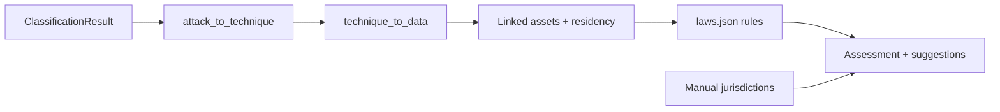

# ADR-001: Threat-to-obligation compliance inference pipeline

**Status:** Accepted  
**Date:** 2026-11-01  
**Branch base:** `fix/ml-hardening` (commit `29b5e02`)

## Context

Today, LBRO creates `ComplianceRecord` and `Notification` rows when an incident is created **only if** the analyst supplied `affected_jurisdictions` and/or personal/health flags (`incidents.py` ~84–88; `ComplianceService.generate_obligations` ~57–84; `NotificationService.generate_for_incident` ~123–173). Deadlines come from duplicated constants: `REGULATION_RULES` hours in `compliance_service.py` and `settings.GDPR_NOTIFICATION_HOURS` / `HIPAA_*` / `DPDPA_*` in `notification_service.py` and `config.py`. There is no link from ML attack class → MITRE technique → data categories → asset residency → legal rule evaluation.

## Decision

Introduce a **versioned knowledge base** (JSON + Pydantic validation at startup) and a **pure inference engine** that produces `IncidentExposureAssessment` results and **suggested** obligations. Humans must **accept or dismiss** each suggestion before it affects dispatch; inferred items never auto-send notifications.

### Pipeline

### Data model (new)

- **assets**, **asset_residency**, **incident_assets** — fictional metadata + record counts only.
- **incident_exposure_assessments** — versioned engine output + trace JSON.
- **compliance_records** extended with `source`, `rule_id`, `assessment_id`, `analyst_decision`, `provisional`, etc. (least invasive vs. a parallel table that would duplicate deadline fields).

### Inference modes (per project)

| Mode | Behaviour |
|------|-----------|
| `manual` | Engine disabled; legacy jurisdiction field only. |
| `hybrid` | Engine runs; suggestions **union** with manual jurisdictions. |
| `inferred` | Engine primary; manual entries still allowed as additions. |

### Confidence and review gating

Assessment is **provisional** when ML `source != model`, `ood_flag`, `needs_review`, or confidence below review threshold, or when asset match confidence is low / counts unknown. Obligations may still be listed but flagged **provisional — analyst confirmation required**.

### Config reconciliation

Rule packs own authoritative deadline windows for **inferred** obligations. Existing `settings.*_NOTIFICATION_HOURS` remain for **legacy manual** path until fully migrated; engine reads deadlines from `laws.json` only. Documented in `docs/COMPLIANCE_INFERENCE.md`.

## Out of scope

- Terraform / infra changes.
- ML model training or classifier internals changes (only consume `ClassificationResult`).
- Automated notification dispatch without approval.
- Legal advice or counsel review of rule packs (all rules ship `legal_review_status: unreviewed`).
- Storing real personal data in assets.

## Risks

| Risk | Mitigation |
|------|------------|
| False-positive breach notifications | Provisional gating; accept/dismiss; trace; conservative technique likelihood |
| Missed obligations | Warnings for unsupported jurisdictions, unmapped classes, no assets |
| Stale legal rules | Versioned knowledge files + `verification_status` + counsel workflow |
| Cross-tenant leakage | Project-scoped queries + IDOR tests |

## Human control

- No inferred `Notification` in `pending` dispatch queue without analyst **accept**.
- Recompute creates new assessment; confirmed assessments not silently overwritten.
